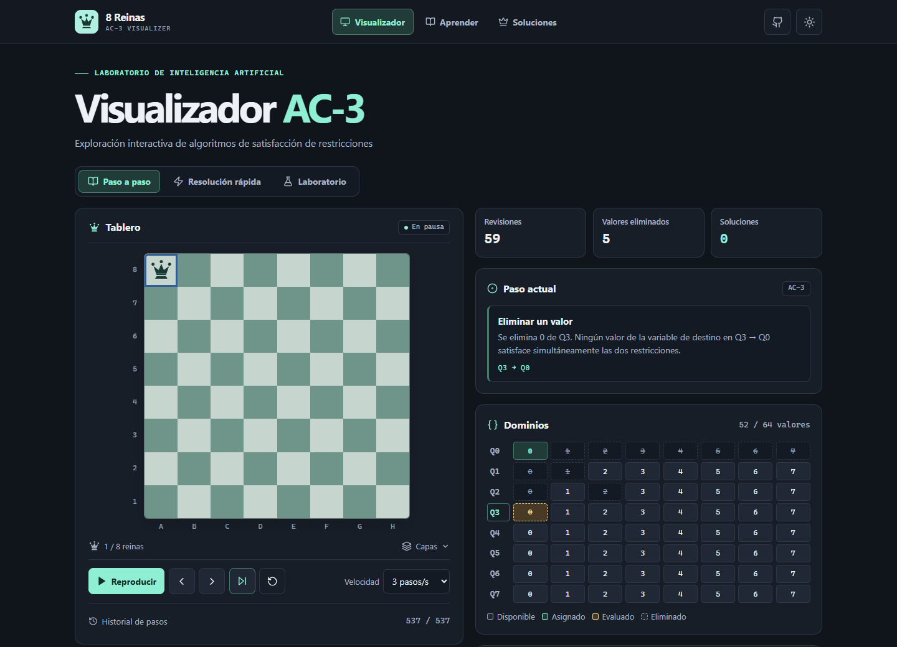
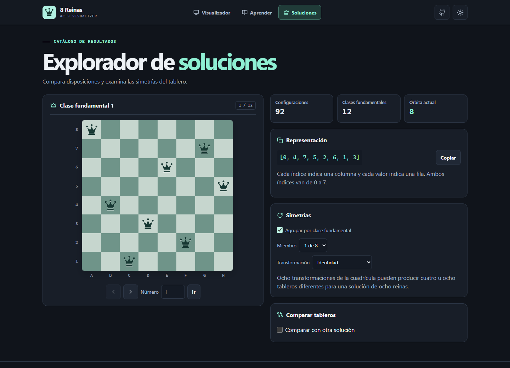
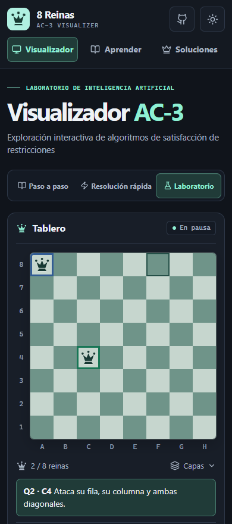
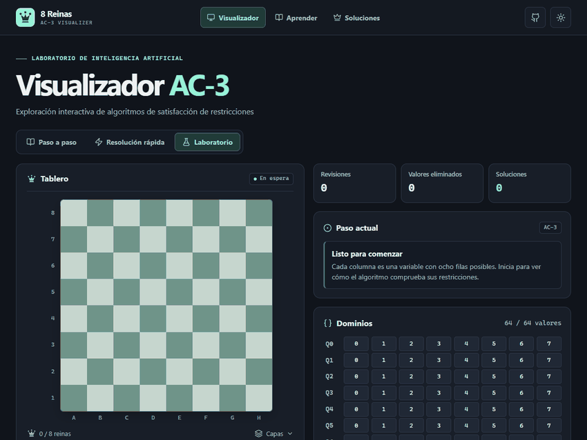
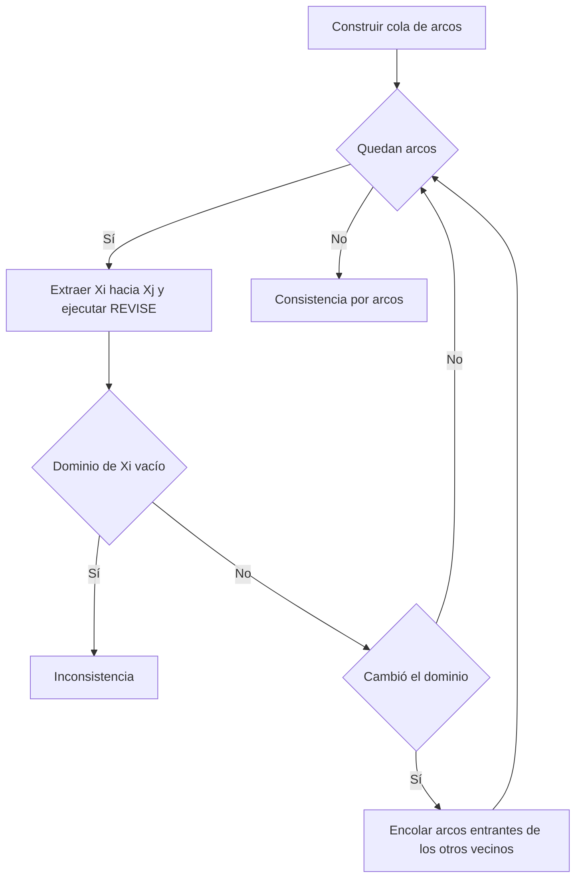
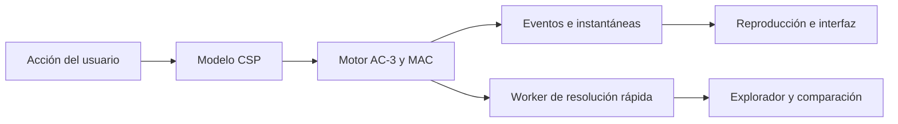

# 8 Reinas | AC-3 Visualizer

**Exploración interactiva de algoritmos de satisfacción de restricciones.** Una plataforma educativa en español para seguir AC-3, observar la propagación en una búsqueda con MAC y comparar las 92 disposiciones válidas del problema clásico.

- [Abrir la aplicación en GitHub Pages](https://ang3lhack.github.io/Problema8reynas/)
- [Consultar las ejecuciones de GitHub Actions](https://github.com/Ang3lhack/Problema8reynas/actions/workflows/deploy.yml)

## Índice

- [Recorrido visual](#recorrido-visual)
- [Problema y objetivos](#problema-y-objetivos)
- [Modelo matemático](#modelo-matemático)
- [AC-3, REVISE y MAC](#ac-3-revise-y-mac)
- [Modos y tutorial](#modos-y-tutorial)
- [Catálogo y estadísticas](#catálogo-y-estadísticas)
- [Arquitectura y archivos](#arquitectura-y-archivos)
- [Instalación y pruebas](#instalación-y-pruebas)
- [Despliegue en GitHub Pages](#despliegue-en-github-pages)
- [Preguntas frecuentes y límites](#preguntas-frecuentes-y-límites)
- [Referencias, licencia y créditos](#referencias-licencia-y-créditos)

## Recorrido visual

**Visualizador.** El tablero muestra los dominios unitarios de la instantánea seleccionada. El panel derecho explica la operación, los valores y el contenido de la cola.



**Explorador.** El catálogo se genera en el navegador y permite cambiar de solución, agrupar por simetría y comparar posiciones.



**Laboratorio en móvil.** Puedes colocar reinas, comprobar su compatibilidad y reproducir la propagación desde esa configuración.



**Demostración.** La secuencia parte del tablero vacío, fija Q0 = 0 y recorre varias podas calculadas por AC-3.



## Problema y objetivos

En un tablero de 8 × 8 se colocan ocho reinas. Cada pareja debe ocupar filas, columnas y diagonales distintas. La versión clásica cuenta cada orientación válida como una configuración diferente.

El objetivo general es recorrer una resolución exhaustiva verificable. Los objetivos específicos son:

- Traducir el tablero a variables, dominios y restricciones binarias.
- Inspeccionar la cola dirigida, los soportes y los cambios de dominio de AC-3.
- Rastrear decisiones, contradicciones y restauración con backtracking y MAC.
- Validar todas las soluciones y explicar su agrupación por simetría.

El visualizador sirve para enseñanza y autoestudio. Cada paso usa los datos producidos por el motor. Puedes retroceder a una instantánea, contrastar la explicación con el dominio vecino y volver a reproducir la misma operación.

## Modelo matemático

Un CSP es una terna de variables, dominios y restricciones. En este caso, `Qi` representa la fila de la reina colocada en la columna `i`. Cada dominio empieza con los enteros del 0 al 7. Con una variable por columna, el modelo incorpora la unicidad de columna.

Para un par de columnas `i ≠ j` se requiere simultáneamente:

- **Fila distinta** con `Qi ≠ Qj`.
- **Diagonal distinta** con `|Qi − Qj| ≠ |i − j|`.

Con `Q0 = 0`, `Q1 = 0` falla por fila y `Q1 = 1` falla por diagonal. `Q1 = 2` satisface ambas. En el tablero la columna 0 es A y la fila CSP 0 es la fila de ajedrez 8. [Modelo CSP y simetrías](docs/modelo-csp.md)

## AC-3, REVISE y MAC

`REVISE(Xi, Xj)` busca en `D(Xj)` un soporte para cada valor de `D(Xi)`. Un soporte satisface conjuntamente ambas restricciones. En la traza detallada se muestran todos los soportes. En el modo rápido basta el primero para conservar el candidato.

AC-3 inicia sobre 56 arcos dirigidos. Extrae de la cola FIFO, revisa el arco y elimina los valores sin soporte. Si se reduce un dominio, pueden perder soporte los vecinos que dependen de él. AC-3 agrega sus arcos entrantes pendientes, con la excepción del vecino recién comprobado. Un dominio vacío implica una contradicción. Si la cola se vacía, los dominios son consistentes por arcos.



Con los 64 candidatos iniciales, cada valor tiene soporte en cada dominio vecino, así que AC-3 completa los 56 arcos sin podar. La consistencia de arcos comprueba cada pareja por separado. Para decidir si todas las asignaciones pueden coexistir, MAC explora ramas.

MAC empieza por una raíz consistente. Para cada decisión guarda los dominios padre, fija una fila y ejecuta AC-3 con los arcos entrantes a la variable modificada. Si hay contradicción, descarta la rama. Si los ocho dominios son unitarios, usa el validador independiente de filas y diagonales. Tras completar cada rama, restaura el estado padre. [Pseudocódigo, complejidad y heurísticas](docs/algoritmo-ac3.md)

## Modos y tutorial

| Modo | Acciones |
| --- | --- |
| **Paso a paso** | Ejecutar AC-3 solo o con búsqueda MAC. Avanzar, regresar, reproducir, pausar, reiniciar, cambiar la velocidad y saltar a una operación importante. Inspeccionar el historial y el árbol filtrable. |
| **Resolución rápida** | Calcular todas las soluciones con un Web Worker. Activar animación opcional, detener el cálculo, comparar estrategias y reiniciar las métricas. |
| **Laboratorio** | Colocar, retirar o asignar reinas, verificar conflictos entre las decisiones manuales, deshacer y ejecutar AC-3 sobre el tablero configurado. |
| **Aprender** | Diez lecciones con definiciones, ejemplos, vínculo al código, un comprobador de soporte, glosario y referencias. |

### Ejecución reproducible de AC-3

1. Abre **Paso a paso**, selecciona **Solo AC-3** en Configuración e inicia. La primera instantánea muestra 56 arcos pendientes.
2. Pulsa **Siguiente evento importante**. Al vaciarse la cola, el panel muestra 56 revisiones y cero valores eliminados. El tablero permanece vacío porque ningún dominio es unitario.
3. Abre **Laboratorio**, selecciona **Probar Q0 = 0** y comprueba que los otros dominios siguen completos.
4. Pulsa **Ejecutar AC-3** y después **Siguiente evento importante**. La primera poda revisa `Q1 → Q0` y quita la fila 0 de Q1 por compartir fila con Q0.
5. Salta al siguiente evento importante. La fila 1 de Q1 pierde soporte por diagonal. Los demás candidatos de Q1 permanecen disponibles en ese instante.
6. Para observar una contradicción, restablece el laboratorio, coloca reinas en A8 y B7, y ejecuta AC-3. La revisión de `Q0 → Q1` vacía D(Q0).
7. Para seguir la búsqueda, vuelve a **Paso a paso**, selecciona **AC-3 + MAC** y usa los saltos para localizar una asignación, una poda o una restauración.

Usa Tab para entrar en el tablero y las flechas para recorrerlo. En el Laboratorio, Espacio o Enter coloca o retira una reina. El encabezado permite cambiar de tema. El control **Reducir movimiento** está en el pie.

## Catálogo y estadísticas

Un arreglo como `[0, 4, 7, 5, 2, 6, 1, 3]` representa ocho filas indexadas por columna. El explorador permite ir a un índice, copiar el arreglo, aplicar transformaciones y marcar diferencias con otra solución.

Las 92 configuraciones incluyen sus rotaciones y reflexiones distintas. Al tomar como representante la menor imagen lexicográfica bajo las ocho transformaciones del cuadrado se obtienen 12 clases. Once clases tienen ocho miembros. La clase restante tiene cuatro.

Los contadores de AC-3 registran arcos extraídos, llamadas a REVISE, valores retirados y dominios vacíos. Los de búsqueda registran decisiones, nodos incluida la raíz, retrocesos, soluciones y profundidad máxima. El tiempo mide cómputo del motor y excluye la espera de reproducción. Resolución rápida conserva la última ejecución completa de cada estrategia para compararlas.

## Arquitectura y archivos

React y TypeScript implementan la interfaz y el motor. Vite genera los recursos estáticos, Lucide proporciona iconos y el tablero y el grafo usan CSS y SVG. Vitest, Testing Library y Playwright verifican el motor, los componentes y el sitio compilado.



```text
8Reynas/
├── .github/workflows/deploy.yml
├── .gitignore
├── LICENSE
├── README.md
├── docs/
│   ├── algoritmo-ac3.md
│   ├── arquitectura.md
│   ├── modelo-csp.md
│   ├── pruebas.md
│   └── capturas/
│       ├── laboratorio-movil.png
│       ├── propagacion.gif
│       ├── soluciones.png
│       └── visualizador.png
├── public/reina.svg
├── src/
│   ├── App.tsx
│   ├── main.tsx
│   ├── styles.css
│   ├── algorithms/
│   │   ├── ac3.ts
│   │   ├── heuristics.ts
│   │   ├── mac.ts
│   │   ├── revise.ts
│   │   └── solver.ts
│   ├── components/
│   │   ├── ChessBoard.tsx
│   │   ├── ExecutionControls.tsx
│   │   ├── Inspector.tsx
│   │   └── Statistics.tsx
│   ├── csp/
│   │   ├── model.ts
│   │   ├── symmetry.ts
│   │   └── validation.ts
│   ├── engine/
│   │   ├── events.ts
│   │   ├── playback.ts
│   │   ├── solver.worker.ts
│   │   ├── usePlayback.ts
│   │   └── useQuickSolve.ts
│   └── pages/
│       ├── Learning.tsx
│       ├── SolutionExplorer.tsx
│       └── Visualizer.tsx
├── tests/
│   ├── e2e/platform.spec.ts
│   ├── integration/components.test.tsx
│   └── unit/engine.test.ts
├── eslint.config.js
├── index.html
├── package-lock.json
├── package.json
├── playwright.config.ts
├── tsconfig.json
├── vite.config.ts
└── vitest.config.ts
```

| Archivo | Responsabilidad | Relación con el algoritmo |
| --- | --- | --- |
| [`src/csp/model.ts`](src/csp/model.ts) | Variables, dominios y arcos | Define A → B y evalúa la compatibilidad de filas y diagonales. |
| [`src/csp/validation.ts`](src/csp/validation.ts) | Validación de tableros y conflictos | Usa conjuntos de filas y diagonales para comprobar las hojas. |
| [`src/csp/symmetry.ts`](src/csp/symmetry.ts) | Rotaciones, reflexiones y agrupación | Define las 12 clases a partir de las soluciones encontradas. |
| [`src/algorithms/ac3.ts`](src/algorithms/ac3.ts) | Bucle de propagación | Extrae, poda y reincorpora arcos. |
| [`src/algorithms/revise.ts`](src/algorithms/revise.ts) | Comprobación de soporte | Enumera soportes de cada candidato. |
| [`src/algorithms/mac.ts`](src/algorithms/mac.ts) | Propagación tras una decisión | Restringe una variable a una fila e inicia AC-3 con arcos entrantes. |
| [`src/algorithms/solver.ts`](src/algorithms/solver.ts) | Búsqueda y retroceso | Explora ramas, restaura el estado padre y registra soluciones validadas. |
| [`src/algorithms/heuristics.ts`](src/algorithms/heuristics.ts) | Orden de variables y valores | Implementa orden fijo, MRV y LCV. |
| [`src/engine/events.ts`](src/engine/events.ts) | Tipos, métricas y explicaciones | Convierte los datos del motor en eventos inspeccionables. |
| [`src/engine/playback.ts`](src/engine/playback.ts) | Historial y cursor | Reutiliza instantáneas al retroceder y limita el trabajo al buscar eventos. |
| [`src/engine/usePlayback.ts`](src/engine/usePlayback.ts) | Temporizadores de reproducción | Conecta el cursor con los controles React. |
| [`src/engine/solver.worker.ts`](src/engine/solver.worker.ts) | Proceso de resolución rápida | Ejecuta la búsqueda fuera del hilo de interfaz. |
| [`src/engine/useQuickSolve.ts`](src/engine/useQuickSolve.ts) | Estado del worker | Conserva resultados completos y la comparación de estrategias. |
| [`src/components/ChessBoard.tsx`](src/components/ChessBoard.tsx) | Tablero y capas | Dibuja los dominios unitarios y los conflictos sin modificar el CSP. |
| [`src/components/ExecutionControls.tsx`](src/components/ExecutionControls.tsx) | Reproducción e historial | Manipula el cursor e inicia una traza. |
| [`src/components/Inspector.tsx`](src/components/Inspector.tsx) | Dominios, cola, pseudocódigo, grafo y árbol | Presenta la instantánea actual. |
| [`src/components/Statistics.tsx`](src/components/Statistics.tsx) | Métricas y comparación | Expone los contadores separados por fase. |
| [`src/pages/Visualizer.tsx`](src/pages/Visualizer.tsx) | Tres modos de ejecución | Conecta las acciones con el CSP, AC-3 y MAC. |
| [`src/pages/SolutionExplorer.tsx`](src/pages/SolutionExplorer.tsx) | Catálogo interactivo | Muestra, transforma y compara los tableros validados. |
| [`src/pages/Learning.tsx`](src/pages/Learning.tsx) | Lecciones | Enseña las restricciones con un ejemplo interactivo. |
| [`src/App.tsx`](src/App.tsx), [`src/main.tsx`](src/main.tsx) | Navegación, preferencias y punto de entrada | Montan React y mantienen el catálogo durante la sesión. |
| [`vite.config.ts`](vite.config.ts), [`deploy.yml`](.github/workflows/deploy.yml) | Compilación y publicación | Generan y sirven la aplicación, incluidos los recursos del worker. |

[Detalles de arquitectura y representación de estado](docs/arquitectura.md)

## Instalación y pruebas

Requisitos: Git, Node.js 22.12 o posterior y npm. La integración continua usa Node.js 24.

```powershell
git clone https://github.com/Ang3lhack/Problema8reynas.git
Set-Location Problema8reynas
npm.cmd ci
npm.cmd run dev
```

Abre `http://localhost:5173/Problema8reynas/` o la URL que imprima Vite. En macOS y Linux puedes usar `npm` y `npx` en lugar de `npm.cmd` y `npx.cmd`.

```powershell
npm.cmd run lint
npm.cmd run typecheck
npm.cmd test
npm.cmd run build
npx.cmd playwright install chromium
npm.cmd run test:e2e
npm.cmd run preview
```

El build queda en `dist/`. La vista previa de producción usa `http://localhost:4173/Problema8reynas/`. Si ya tienes Edge instalado, puedes ejecutar E2E con `$env:PLAYWRIGHT_CHANNEL = 'msedge'`.

La prueba de referencia reconstruye el conjunto de 92 configuraciones mediante una enumeración separada que solo vive en las pruebas. Las tres heurísticas deben producir exactamente el mismo conjunto. Las pruebas de interfaz cubren el teclado, reproducción, laboratorio, búsqueda, selección inválida, simetrías y diseño móvil. [Matriz de pruebas y comandos](docs/pruebas.md)

La validación local de esta versión completó la instalación limpia, lint, tipado y build de producción. Pasaron 13 pruebas de motor e integración en Vitest y 5 recorridos E2E en Edge. GitHub Actions vuelve a ejecutar ambos conjuntos antes de publicar.

## Despliegue en GitHub Pages

1. En el repositorio, abre **Settings → Pages → Build and deployment → Source → GitHub Actions**.
2. Un push a `main` inicia el workflow. También se puede iniciar manualmente desde **Actions → Validar y publicar en Pages → Run workflow**.
3. Tras instalar dependencias, lint, tipado, pruebas, build y Playwright, el workflow carga `dist/` y lo publica mediante el entorno `github-pages`. El trabajo de publicación recibe permisos `pages: write` e `id-token: write`.
4. Verifica la página publicada y ejecuta **Resolución rápida → Resolver**. Debe aparecer **92 soluciones verificadas**. Verifica `#aprender` y `#soluciones` para comprobar la navegación.

Vite usa `base: '/Problema8reynas/'`. Los fragmentos de URL conservan las rutas en un alojamiento estático. [Configurar el origen de Pages en GitHub](https://docs.github.com/en/pages/getting-started-with-github-pages/configuring-a-publishing-source-for-your-github-pages-site)

## Preguntas frecuentes y límites

- **El primer AC-3 no elimina candidatos.** Con dominios completos hay soporte para cada valor. Fija Q0 = 0 en el Laboratorio para ver una poda.
- **Veo un ataque en el tablero sin cambios en otros dominios.** Las capas marcan relaciones geométricas. Ejecuta AC-3 para calcular qué candidatos pierden soporte.
- **El botón Copiar no funciona.** El permiso del portapapeles puede depender del navegador y de que la página esté en HTTPS o localhost. El arreglo también se puede seleccionar manualmente.
- **El worker o los recursos fallan al abrir `index.html`.** Sirve el proyecto con Vite o el directorio `dist/` con HTTP bajo la ruta base configurada.
- **La búsqueda se detuvo.** Las métricas muestran el último lote recibido. El catálogo conserva la última enumeración completa disponible durante la sesión.
- **La traza se pierde al recargar.** Las instantáneas, métricas y soluciones viven en memoria. El tema y la preferencia de movimiento pueden persistir localmente.

El laboratorio está diseñado para N = 8 y usa una variable por columna. Como extensiones futuras se podrían exportar trazas, agregar una vista del árbol por niveles o comparar AC-3 con otras técnicas de propagación.

## Referencias, licencia y créditos

- Alan K. Mackworth (1977), *Consistency in Networks of Relations*, Artificial Intelligence 8(1), 99–118. [Artículo del autor](https://www.cs.ubc.ca/~mack/Publications/AI77.pdf)
- Edsger W. Dijkstra (1971), *The problem of eight queens*, capítulo 9 de *A Short Introduction to the Art of Programming*. [Archivo EWD](https://www.cs.utexas.edu/~EWD/transcriptions/EWD03xx/EWD316.9.html)
- Yuanlin Zhang y Roland H. C. Yap (2001), *Making AC-3 an Optimal Algorithm*, IJCAI. [Actas](https://ijcai.org/proceedings/2001/45)
- [Guía oficial de Vite para despliegue estático](https://vite.dev/guide/static-deploy.html#github-pages)

Proyecto [Ang3lhack](https://github.com/Ang3lhack). Código y documentación bajo [licencia MIT](LICENSE). Iconos de interfaz de [Lucide](https://lucide.dev/license). El tablero y las piezas SVG se realizaron para el proyecto.
