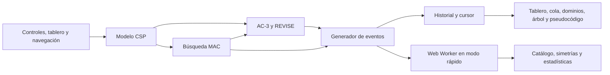

# Arquitectura

La aplicación es estática. React presenta el tablero y recibe eventos de un motor en TypeScript que también se ejecuta en Vitest.

## Flujo de datos

1. Una interacción selecciona el modo, modifica la configuración manual o solicita el siguiente evento.
2. Los generadores reciben dominios inmutables. Una poda crea un nuevo arreglo exterior y reemplaza el dominio afectado. Los dominios intactos se comparten.
3. El motor construye cada evento con identificador, operación, rama, tablero derivado y copia de las métricas. Un evento puede conservar las colas o dominios previos, el arco, la fila revisada, los soportes o el resultado.
4. `Playback` conserva los eventos generados y mueve el cursor para revisar el pasado. Saltar busca el siguiente evento significativo en lotes de hasta 250 eventos. El árbol usa un índice de eventos de rama y muestra 16 entradas por página.
5. El modo rápido usa el mismo motor desde `solver.worker.ts` y detiene el escaneo de soporte al encontrar uno. Envía resultados por lotes y al completar produce el catálogo. Detener termina el worker.
6. La navegación usa fragmentos de URL. El tema y la preferencia de movimiento se guardan localmente si el navegador lo permite.

## Límites de la implementación

La traza detallada vive en memoria durante la sesión. El proyecto fija el tamaño en 8 para mantener el tablero, las lecciones y la enumeración dentro del alcance didáctico. Las dos vistas de trabajo conservan su historial al cambiar de sección mientras la pestaña siga abierta. El catálogo calculado también se conserva durante la sesión.
